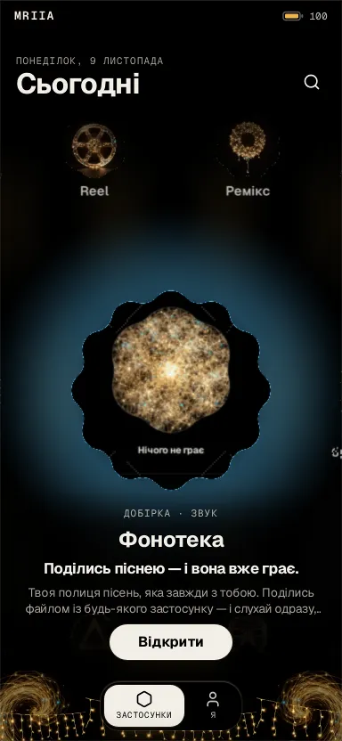
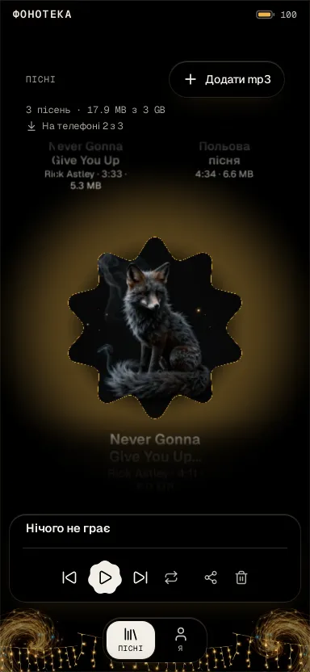
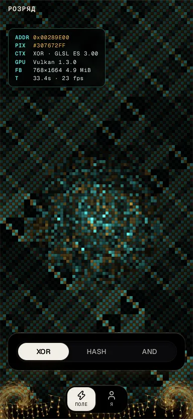
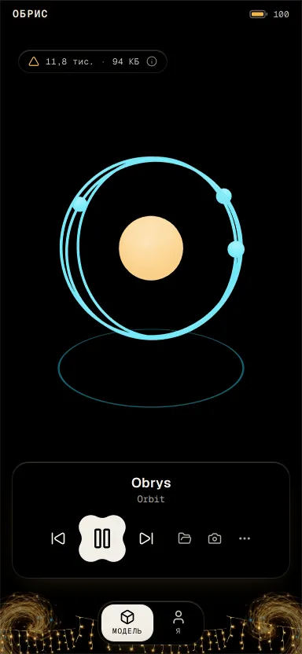
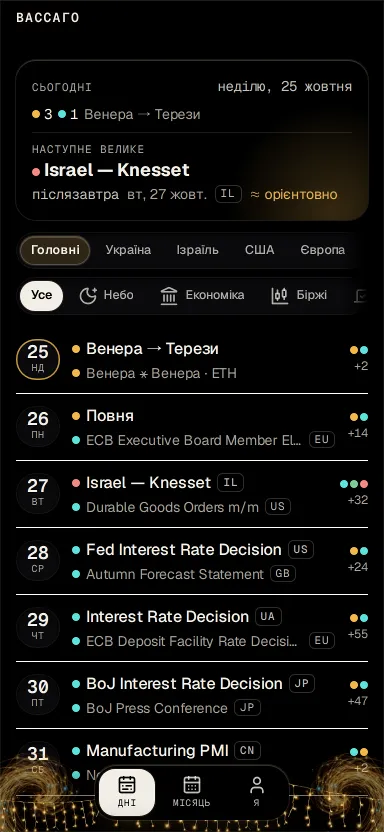
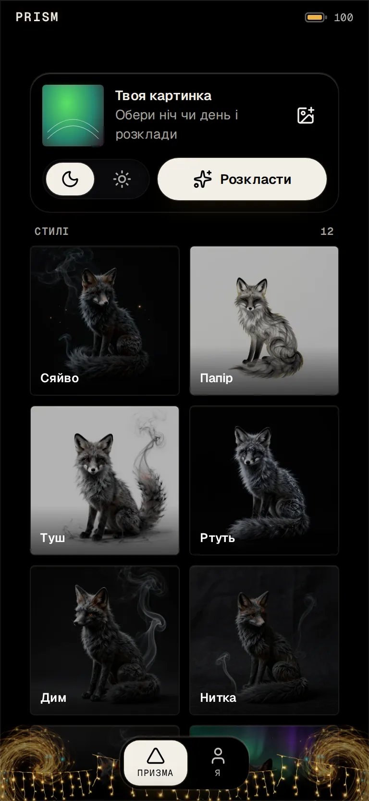

# Mriia

**A farm of installable micro-apps, woven from light.**

### **[▶ Open the store](https://mriia.si/store/)** — add any app to your home screen.

 

<table>
<tr>
<td width="33%">
<b>Store</b> · a honeycomb, from the centre out. The resting cell grows.
</td>
<td width="33%">
<b>Fonoteka</b> · your songs as cells. The playing one wears its spectrum.
</td>
<td width="33%">
<b>Rozriad</b> · a million bits, recomputed every frame. Touch, and they boil.
</td>
</tr>
<tr>
<td width="33%">
<b>Obrys</b> · open a .glb from your phone, a link or your Mriia models.
</td>
<td width="33%">
<b>Vassago</b> · what is already known about the days ahead.
</td>
<td width="33%">
<b>Prism</b> · one picture, every material at once.
</td>
</tr>
</table>

**95 installable apps** — sound, tools, feeds, creative work, science, radio, games, money, wellness, esoterica. Dark is the moon's side, light is the sun's.

---

## Principles

Light is the structure. True black, one amber, one cyan. Volume is bloom, not shadow — a shadow fails the gate.

A set of like things is a honeycomb. It grows from the centre. Nothing scrolls to the bottom.

A cell has two states: itself, and itself grown — with its picture, its caption and the neighbours pushed aside. Nothing slides up over the field.

Events, not timers. The machine says when it rests, when it opens, when it is live. Nothing waits a number of milliseconds.

The store is a launcher. Delight sits on top of findability, never instead of it.

English under the hood, a real translation for the reader. Copy is one image, no mechanics, no numbers.

The battery is the budget. A field at rest draws zero frames. Heavy work lives in bytes and on the GPU.

Code is a black box. No comments; JSDoc on exports only, because the registry renders it.

Red stops the change.

## How it is built

Every app is one `spec.json` and one `view.js` on two runtime halves.

- **[`@microspec/core`](https://jsr.io/@microspec/core)** — the appless core on JSR, pinned to one exact version. It serves `/_rt`, holds the schema, the gates and the kit. It knows nothing about these apps.
- **`rt/`** — this farm's domain half: radio demodulation, astrology mathematics, instrument theory, the theme material, the WebUSB drivers that talk to real hardware from a browser tab.
- **`apps/`** — 95 directories. Each declares its tabs and cards, writes one view, and inherits routing, offline, accessibility, i18n and the honeycomb from the core.
- **`wasm/`** — the vendored engines, committed like codecs. The machines (Rozriad, the comb) are hand-written bytes plus a shader.

## How it ships

Every push runs the browser-free gate DAG. A real Chromium then sweeps every affected app: axe in both themes, an eight-viewport matrix, the app's own e2e, offline precache, runtime errors. The built site passes a measured eye before rsync. The same contract draws the 95 icons, the store and the chrome.

The `dev` branch lands on a pod on the server. The eye looks there. Nothing runs on the phone that built it.

Built on <a href="https://github.com/damanoreshkan-beep/microspec">microspec</a> — the appless core this product proves.

