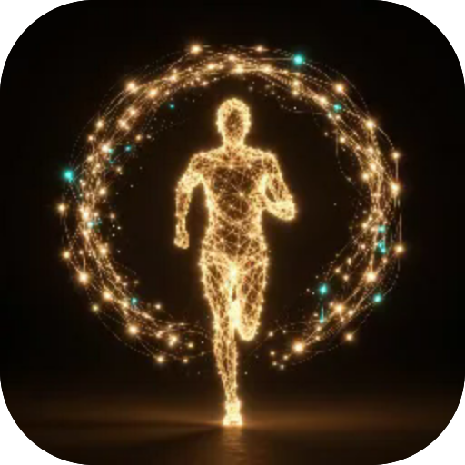

# Blackout

**The city goes dark behind you, and out of that dark run the ones it already took. Run while the streetlights last — and make a runner from your own words, or your own photo.**

  

---

**Screens** Run · Shop  ·  **Capabilities** —  ·  **Offline** yes  ·  **Installable** yes

Part of the **[microspec farm](../../)** — an AI-authored, gated micro-PWA. Every screen is accessible,
responsive, installable and offline by construction. Browse the whole set from the **[store](../store/)**.

Generated from `spec.json` + `i18n/` by `deploy/readme.mjs` — edit the app, not this file.
