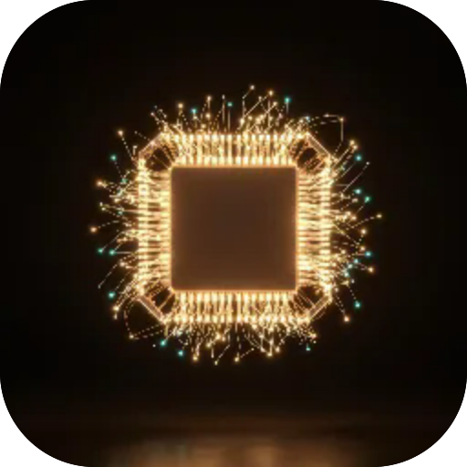

<div align="center">



# microspec OS

**What this device lets an app do**

  

</div>

---

**Screens** Device · Radar · Files · Alarms  ·  **Capabilities** —  ·  **Offline** yes  ·  **Installable** yes

---

## Control bridge — MCP

microspec OS turns the phone into something an agent can drive. It runs a local **MCP** server: a terminal, or Claude, speaks JSON-RPC to it and the phone answers. With the accessibility service on it can drive any app like a person — read the screen, tap, type, scroll — on top of the system controls below. The server binds to `127.0.0.1`, every call carries a bearer token, and nothing leaves the device.

- **Endpoint** `http://127.0.0.1:8765/mcp`
- **Transport** JSON-RPC 2.0 over HTTP (also `GET /x/<action>` for a quick shot)
- **Auth** Bearer token — shown and copied on the Bridge screen

**Screen**

- `brightness` — read or set screen brightness
- `rotation` — lock to portrait or landscape, or auto
- `filter` — a colour tint over the screen
- `image` — a full-screen image overlay
- `scene` — a full-screen image above the lock screen; wakes the screen
- `screenshot` — capture the screen as a PNG
- `record` — record the screen to an MP4
- `wake` — turn the screen on
- `torch` — flashlight on or off
- `vibrate` — a haptic buzz

**Sound**

- `volume` — read or set a stream's volume
- `ringer` — normal, vibrate or silent
- `dnd` — Do Not Disturb
- `media` — play, pause, next, prev
- `speak` — text-to-speech in the phone's own voice

**Navigation & input (accessibility)**

- `access` — turn the service on; it also forwards the volume keys as triggers, even locked
- `nav` — back, home, recents, notifications, quick settings, lock, power, split
- `tap` / `swipe` — gestures at a pixel
- `click` — tap a control by its on-screen text
- `scroll` — scroll the content forward or backward
- `type` — type into the focused field
- `screen` — read the on-screen text and controls
- `foreground` — the app on screen right now

**Apps & routes**

- `apps` — a manifest of every installed app and the deep-link protocols it answers
- `open` — open a URL or an app route; it reaches the screen even from the background
- `launch` — start an app by package name

**System**

- `lock` — lock the screen now (device admin)
- `info` — device facts
- `battery` — charge and power state
- `wifi` — network state
- `settings` — jump to a system settings page
- `clip` — read or write the clipboard
- `notifs` — read the notifications seen since start
- `audit` — what can watch the device: accessibility, device admins, VPN

**Data**

- `contacts` — read the address book
- `calendar` — read upcoming events
- `call` — place a call

**Triggers**

- `/t/<key>` — a URL hook anything that opens a link can fire (browser, NFC tag, routine, shortcut); `events` drains them
- `taps` — count screen taps to stop a scene
- volume-key combos — N presses up then down, read through `events`, work on the lock screen

**Example** — open a Telegram chat with the message already typed

```
open  https://t.me/share/url?text=Hello%20from%20the%20bridge
```

Part of the **[microspec farm](../../)** — an AI-authored, gated micro-PWA. Every screen is accessible,
responsive, installable and offline by construction. Browse the whole set from the **[store](../store/)**.

<sub>Generated from `spec.json` + `i18n/` by `deploy/readme.mjs` — edit the app, not this file.</sub>
