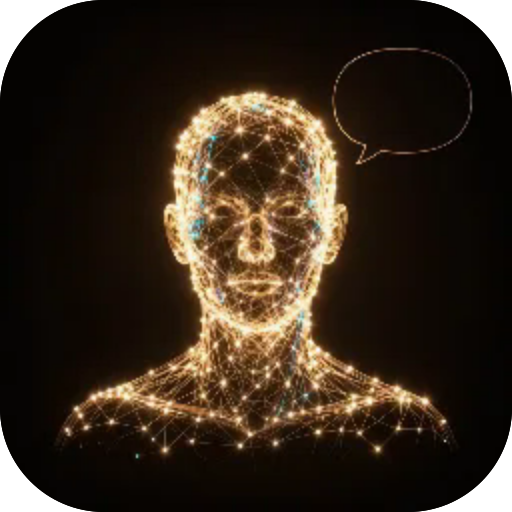

# Personas

**Made-up people from your audience you can question. Say who the idea is for and get people with photos, money and habits, talk to each one and compare who would pay how much.**

  

---

**Screens** People · Compare  ·  **Capabilities** —  ·  **Offline** yes  ·  **Installable** yes

Part of the **[microspec farm](../../)** — an AI-authored, gated micro-PWA. Every screen is accessible,
responsive, installable and offline by construction. Browse the whole set from the **[store](../store/)**.

Generated from `spec.json` + `i18n/` by `deploy/readme.mjs` — edit the app, not this file.
