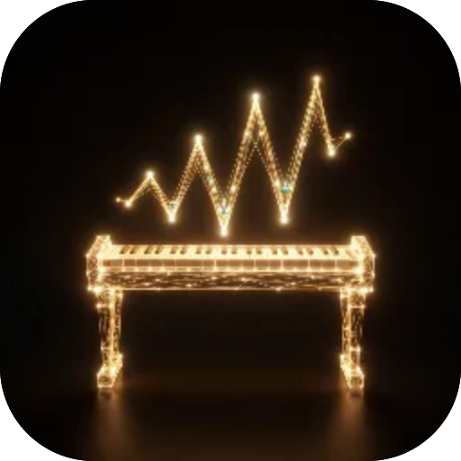
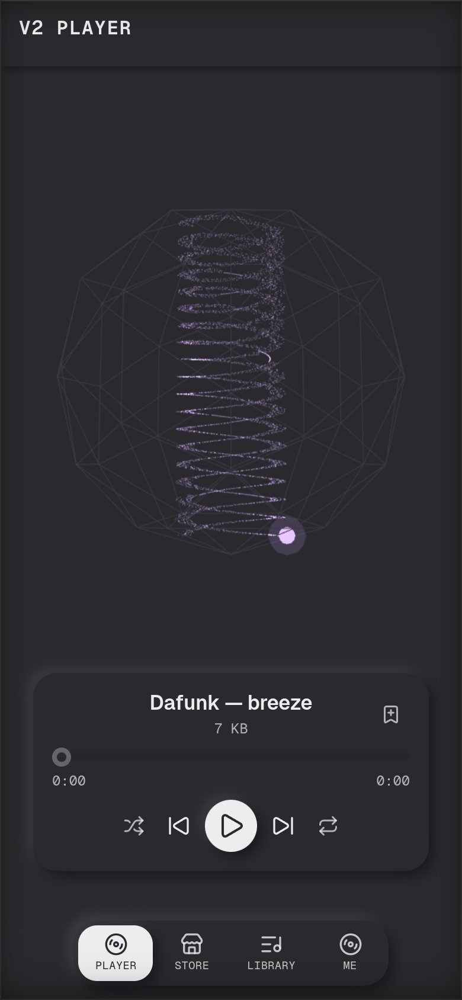

# V2 Player

**A player for legendary demoscene music. Whole tracks weigh a few kilobytes, so they download instantly and stay for good; plays in the background with lock-screen controls.**

  

 

---

**Screens** Player · Store · Library  ·  **Capabilities** —  ·  **Offline** yes  ·  **Installable** yes

Part of the **[microspec farm](../../)** — an AI-authored, gated micro-PWA. Every screen is accessible,
responsive, installable and offline by construction. Browse the whole set from the **[store](../store/)**.

Generated from `spec.json` + `i18n/` by `deploy/readme.mjs` — edit the app, not this file.
